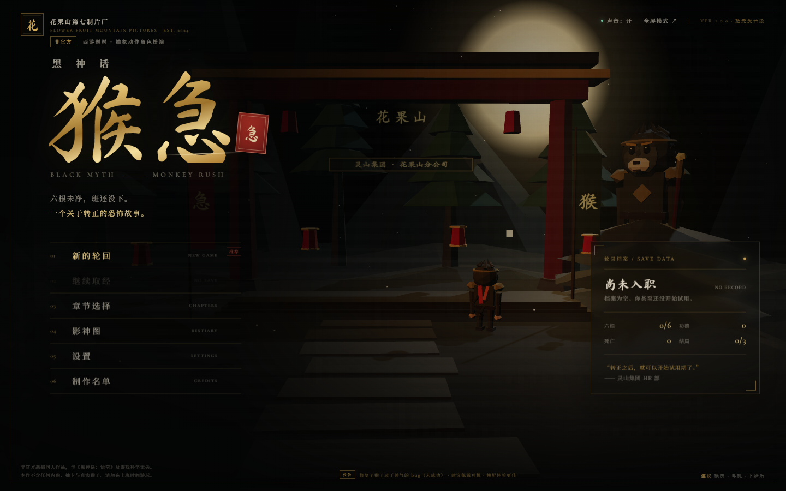
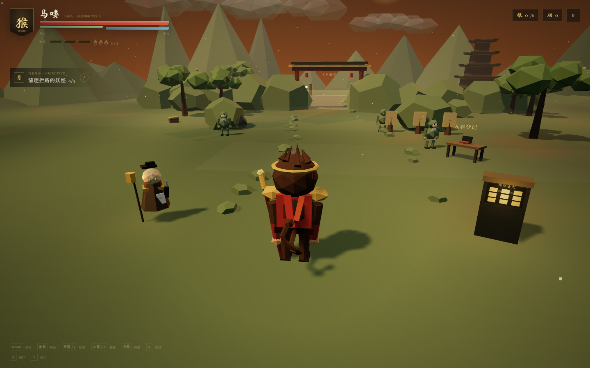
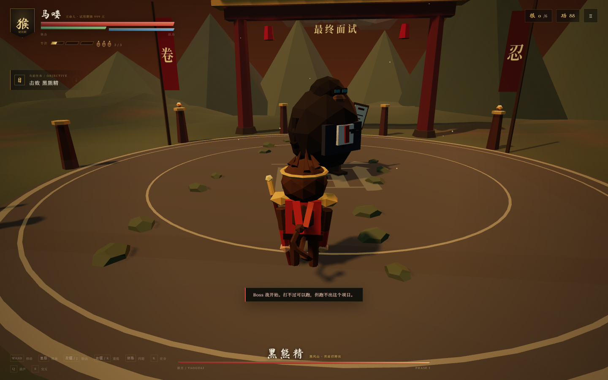
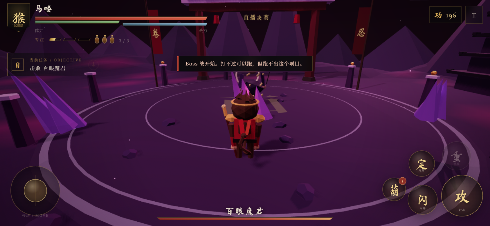

# 黑神话：猴急 · BLACK MYTH: MONKEY RUSH

> 六根未净，班还没下。  
> 一个关于转正的恐怖故事。

一款**手机端 3D 抽象动作 RPG**。初始菜单和 UI 认真到过分，游戏世界却是一堆低模几何体。你将扮演试用期第 999 天的猴子「马喽」，替一位已经跑路的前任大圣找回抵押给天庭小贷的六根，顺便经历一场又一场离谱的面试、团建、直播、外卖与烧烤。

**非官方恶搞同人作品，与《黑神话：悟空》及游戏科学无关。**  
游戏免费、无内购、无抽卡、无广告，也没有任何真实猴子受到伤害。



## 立即游玩

**在线地址：** [https://real-benguo.github.io/heishenhua-houji/](https://real-benguo.github.io/heishenhua-houji/)

推荐使用手机横屏游玩，或桌面 Chrome / Edge。  
第一次进入游戏会下载约 20–40 MB 的字体与脚本资源（主要是中文字体），请耐心等待。

## 这是什么

- **7 个章节**：序章 + 六回正篇，包含两条过场线索、多段 Boss 战与 3 个结局。
- **正经的 UI**：全屏主菜单、章节选择、影神图、设置、难度选择、制作名单、暂停、商店、结算、结局页。
- **不正经的世界**：低模猴子、纸片简历怪、雪人讲师、蜘蛛主播、烧烤摊熊孩子、外包六耳猕猴。
- **可玩的战斗**：轻击连段、重棍、闪避无敌帧、完美闪避、定身术、葫芦回血、专注系统。
- **成长与收集**：功德、共享香火升级、隐藏功德箱、六根收集、影神图解锁。
- **程序化音画**：所有模型、贴图、场景与音乐音效均由代码生成，不依赖任何外部付费素材。





## 操作

### 桌面端

| 操作 | 键位 |
| --- | --- |
| 移动 | `WASD` / 方向键 |
| 视角 | 鼠标（首次点击画面锁定） |
| 轻击 | 鼠标左键 / `J` |
| 重棍 | 鼠标右键 / `K` |
| 闪避 | `Space` |
| 定身术 | `R` |
| 葫芦回血 | `Q` |
| 交互 / 拾取 | `E` |
| 暂停 | `Esc` |

### 手机端

- 左下虚拟摇杆移动。
- 右侧空白区域拖动旋转视角。
- 右下角按钮：攻 / 闪 / 重 / 定 / 葫。
- 靠近香火、土地公、功德箱或六根后，点击屏幕中央的交互提示。



## 六回

| 回目 | 地点 | 妖王 | 六根 |
| --- | --- | --- | --- |
| 序 | 花果山 · 人才市场 | 石敢当 · 保安队长 | — |
| 第一回 | 黑风山 · 春季招聘会 | 黑熊精 · 首席招聘官 | 眼根 · 绩效之眼 |
| 第二回 | 黄风岭 · 超时外卖站 | 黄风大圣 · 金牌骑手 | 耳根 · 单只降噪耳机 |
| 第三回 | 小西天 · 强制团建基地 | 黄眉 · 金牌讲师 | 鼻根 · 画饼味香薰 |
| 第四回 | 盘丝洞 · 直播基地 | 百眼魔君 · 头部主播 | 舌根 · 直播麦克风 |
| 第五回 | 火焰山 · 烧烤一条街 | 红孩儿 · 烧烤摊少主 | 身根 · 健身年卡 |
| 终回 | 花果山 · 最终面试 | 六耳猕猴 · 外包项目经理 | 意根 · 齐天大圣工牌 |

三个结局分别对应三张不同的离职证明。具体怎么选，取决于你还想不想上班。

## 本地运行

需要 Node.js 20+。

```bash
npm install
npm run dev
```

打开 `http://127.0.0.1:5174/`。

构建生产版本：

```bash
npm run build
npm run preview
```

`dist/` 可以直接部署到任意静态站点托管。本项目使用 GitHub Pages：

- `main` 分支保存源代码。
- 构建产物同步在 `docs/` 目录，GitHub Pages 从 `main` 的 `/docs` 目录发布。
- Vite 使用相对资源路径，因此可部署在子目录下。

```bash
npm run build
# 将 dist/ 的内容同步到 docs/ 后提交
```

## 技术

- **Three.js**：程序化低模场景、角色、Boss、粒子、镜头、战斗判定。
- **Vite**：开发与构建。
- **原生 DOM / CSS**：所有菜单、HUD、对话、过场、弹窗。
- **Web Audio API**：程序化五声音阶配乐、太鼓、木鱼、风声及全部音效。
- **localStorage**：本地存档、设置、影神图、结局与死亡统计。
- **零外部美术 / 音频素材**：只使用 npm 安装的开源中文字体。

## 设计参考

制作前研究了《黑神话：悟空》的公开资料与玩法框架，并以恶搞方式进行重新拆解：

- 六根 / 六识收集与章节式西游叙事
- 土地庙存档点、葫芦回血、定身术、棍势与三种棍法
- 妖王战、影神图、章节结束过场
- 精英怪与“看起来很有野心”的低模动作演出

参考链接：

- [Black Myth: Wukong — Wikipedia](https://en.wikipedia.org/wiki/Black_Myth:_Wukong)
- [Black Myth: Wukong Review — GameSpot](https://www.gamespot.com/reviews/black-myth-wukong-review-monkey-business/1900-6418269/)
- [《黑神话：悟空》全章节剧情详细解读 — 9game](https://www.9game.cn/hshwk/10433204.html)

原作是 Game Science 的优秀作品。本作只是同人恶搞，请支持正版。

## 免责声明

本作是一款非官方、非商业的恶搞同人游戏，与《黑神话：悟空》、游戏科学（Game Science）及其他相关权利方无任何关联。  
游戏中的公司、角色、事件、KPI 与“福报”均为虚构。如有雷同，说明你也在加班。  
本项目不提供任何形式的商业授权；如需转载或二次创作，请保留本声明并注明出处。

## License

源代码采用 MIT License。详见 [LICENSE](LICENSE)。  
《黑神话：悟空》及相关名称、角色与商标归其各自权利人所有，本仓库不主张任何相关权利。

---

**“离职不是失败。离职是把自己从别人的 KPI 里赎回来。”**
